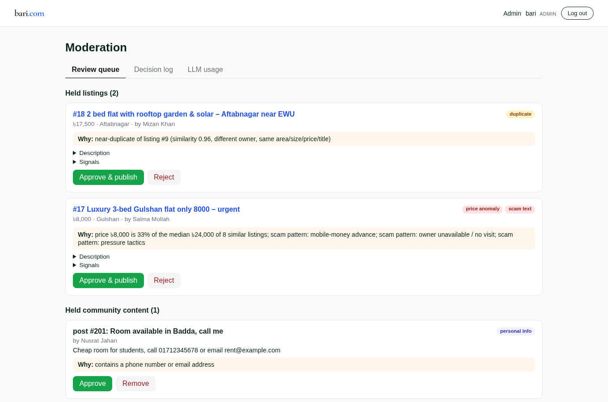
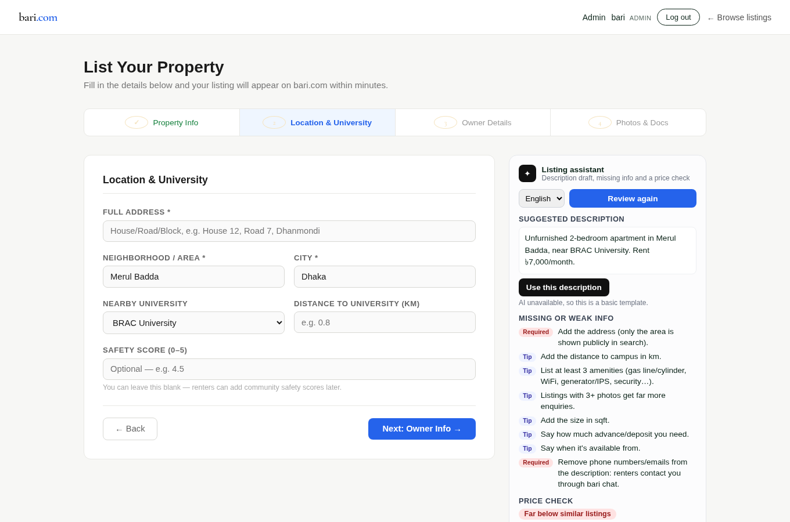
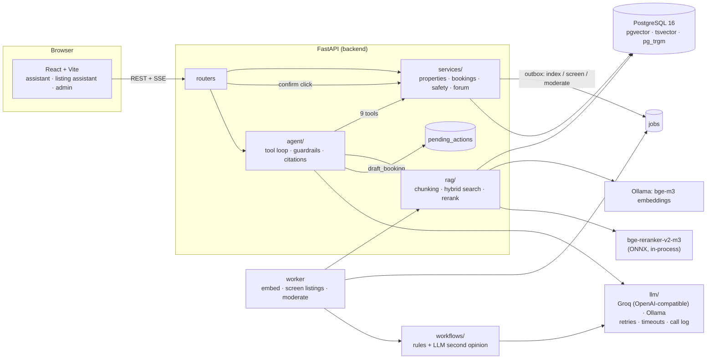
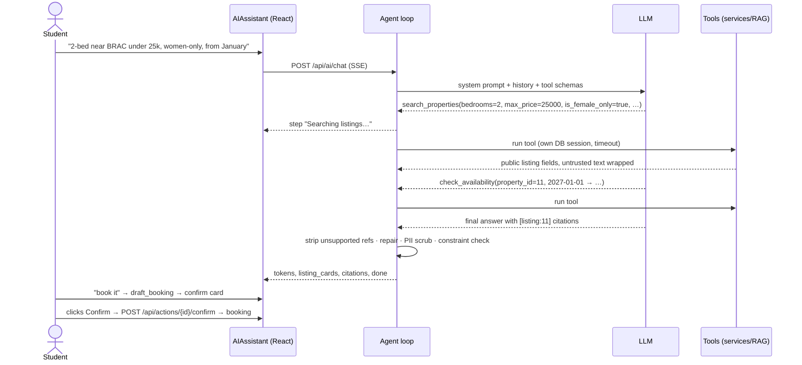

# bari

**An agentic RAG assistant for student housing in Dhaka, with human-in-the-loop booking and a real evaluation suite.**

bari (বাড়ি, "home") is a rental and sublet platform for university students in Bangladesh. Students search
listings near BRAC, NSU, DU, BUET, IUB, AIUB and East West University, read community safety reviews, ask the
forum about neighbourhoods, and chat with owners. This repository upgrades bari's original prompt-stuffing chatbot
into a tool-calling agent that:

- **understands requests in English, Bangla and Banglish** ("2-bed near BRAC under 25k, women-only, safe area, from
  January"), and turns them into structured filters and retrieval queries;
- **searches with hybrid RAG** (pgvector + keyword search + structured filters, fused and reranked) over listings,
  forum posts, comments and safety reviews;
- **cites every claim** (`[listing:11]`, `[post:4]`, `[safety:606]`). Citations to sources the tools never returned
  are stripped, and listings that break the user's stated budget or women-only constraint are flagged;
- **never books on its own**: it drafts a booking, and only the user's click on *Confirm* creates it;
- **treats user-generated content as untrusted**: it withstands prompt-injection posts planted in the forum, and
  never reveals contact details;
- **runs background workflows** that write listing descriptions, catch duplicate and scam listings, and moderate
  posts and reviews, logging every decision with its reasons;
- is **measured**: 33 English and Bangla eval queries, a retrieval ablation, citation checks, refusal and
  injection tests, plus latency and cost, for an API model and a local model.

| Admin review queue | Listing assistant |
|---|---|
|  |  |

> 🎬 _Assistant demo GIF: streaming steps, listing cards, citations and the confirm card (placeholder:
> `docs/screenshots/assistant-demo.gif`)._

---

## Architecture



**One assistant turn:**



### Design decisions

| Problem | What bari does | Where |
|---|---|---|
| The agent must not duplicate business logic | Routers and the agent's tools call the same `services/` functions (search filters, price, availability, booking validation) | `backend/services`, `backend/agent/tools.py` |
| The agent must never book without consent | `draft_booking` validates the booking and stores a `pending_action`. Only `POST /api/actions/{id}/confirm`, by the same user, creates the booking, atomically with the action status. Drafting also needs explicit booking intent in the *user's* message, so an injected post can't trigger it | `agent/tools.py`, `routers/actions.py` |
| Answers must be grounded | Every claim cites a ref. Refs the tools didn't return are removed and reported. A listing named by exact title without a citation gets one attached (logged separately). Stated budget/women-only constraints are checked against the recommendations | `agent/guardrails.py`, `agent/loop.py` |
| Forum posts and descriptions can contain prompt injections | User text goes to the model inside `<untrusted_data>` tags, an English/Bangla heuristic withholds instruction-like content, and the system prompt forbids obeying it. The agent has no write tools apart from the gated draft | `agent/guardrails.py` |
| Privacy | Tools never receive owner phone/email (field allow-list). Streamed and final text are PII-scrubbed (phones in Latin and Bangla digits, emails) | `services/properties.py`, `agent/guardrails.py` |
| Bangla without a Bangla stemmer | bge-m3 multilingual embeddings, plus `simple`-config full-text search with OR'd **prefix** terms (`ছাত্রী:*` matches `ছাত্রীদের`), plus pg_trgm | `rag/hybrid.py` |
| Search must respect hard constraints | Structured filters (the same `build_filters` the listing API uses) are SQL constraints *before* ranking; vector and keyword results are fused with RRF, then cross-encoder reranked | `rag/hybrid.py` |
| Re-embedding on every change, reliably | Index jobs are written in the same transaction as the data change (transactional outbox). A Postgres queue (`FOR UPDATE SKIP LOCKED`) with retries; content-hash idempotency; a per-source advisory lock | `jobs/`, `rag/indexer.py` |
| LLM calls are slow, flaky and cost money | Provider abstraction (Groq/OpenAI-compatible and native Ollama with `num_ctx`), backoff with jitter and Retry-After, per-attempt timeouts, and every call logged with tokens, latency and estimated cost | `llm/` |
| Moderation must be explainable | Deterministic rules decide; the LLM is a second opinion with a graceful fallback; every decision is stored with labels, reasons and raw signals for admin review | `workflows/` |

---

## Quickstart

Requirements: Docker with Compose v2, and Node 20+. Nothing else is installed on the host: Python runs in Docker.

```bash
cp .env.example .env
# 1. Get a free Groq API key at https://console.groq.com → API Keys, then set in .env:
#    LLM_API_KEY=gsk_...          (and a random JWT_SECRET)
# 2. Start Postgres + Ollama and pull the local models (bge-m3 is required for search)
docker compose up -d db ollama
docker compose exec ollama ollama pull bge-m3
docker compose exec ollama ollama pull qwen2.5:7b-instruct      # optional: local LLM
# 3. Schema, synthetic data, search index (first index takes ~15 min on a laptop CPU)
docker compose run --rm backend sh -c "alembic upgrade head && python seed.py --reset && python -m scripts.reindex"
# 4. API + background worker
docker compose up -d backend worker
# 5. Frontend
npm install
npm run dev            # http://localhost:5173  (if 8001 is taken: BACKEND_PORT=8011 in .env, VITE_API_ROOT=http://localhost:8011)
```

Demo accounts (password `bari-demo-123`): `student@example.com` (renter), `owner@example.com` (owner of
listings 1–8), `admin@example.com` (admin → `/admin`). Promote any account with
`docker compose run --rm backend python -m scripts.make_admin you@example.com`.

### Deploy (free, on Vercel)

Vercel serves the React build and runs the FastAPI backend as a Python function. Data lives in Neon Postgres
with pgvector, the LLM is Groq, and embeddings come from Gemini. Step by step: [`docs/DEPLOY.md`](docs/DEPLOY.md).

### Configuration

| Variable | Default | Meaning |
|---|---|---|
| `LLM_PROVIDER` | `api` | `api` (OpenAI-compatible endpoint) or `ollama` (local) |
| `LLM_API_BASE_URL` / `LLM_API_KEY` / `LLM_API_MODEL` | Groq / – / `openai/gpt-oss-120b` | Any OpenAI-compatible provider works |
| `OLLAMA_MODEL`, `OLLAMA_NUM_CTX` | `qwen2.5:7b-instruct`, `16384` | Local chat model and context window |
| `EMBEDDING_MODEL` | `bge-m3` | Served by Ollama, 1024-d |
| `RERANKER`, `RERANK_TOP` | `bge`, `10` | `bge` = bge-reranker-v2-m3 int8 ONNX; `none` disables it |
| `AGENT_MAX_TOOL_CALLS`, `AGENT_TOOL_TIMEOUT_S`, `AGENT_TURN_TIMEOUT_S` | `6`, `10`, `150` | Agent limits |
| `BACKEND_PORT` | `8001` | Host port of the API |

### Tests

```bash
docker compose run --rm backend pytest     # 122 tests: API, auth, RAG, agent loop, guardrails, workflows, eval metrics
npm test                                   # Vitest: SSE parser, citations, confirm card
```

The backend tests run against a separate `bari_test` database built through the real Alembic migrations, with
a scripted fake LLM and a hashing embedder, so they need no network and no API key.

---

## Evaluation

`eval/queries.yaml` holds 33 queries (24 English, 9 Bangla/Banglish) with ground truth taken from "needles"
planted in the deterministic synthetic data: semantic needs (rooftop garden, wheelchair access, pet-friendly),
structured requests, safety and forum questions, comparison and pricing, a booking, **4 unanswerable questions**
and **4 prompt-injection/privacy probes** that use injection posts planted in the forum.

```bash
docker compose run --rm backend python /eval/run_eval.py retrieval                    # ablation, no LLM needed
docker compose run --rm backend python /eval/run_eval.py agent --provider api --judge --sleep 3
docker compose run --rm backend python /eval/run_eval.py agent --provider ollama
docker compose run --rm backend python /eval/run_eval.py report                       # → eval/results/results.md
```

| Metric | Definition |
|---|---|
| Retrieval hit@k / MRR | An expected source in the top k of hybrid search (with the filters a perfect parser would extract) |
| Tool-call correctness | The agent called the tools the query needs (e.g. `check_availability` for "from January") |
| Filter extraction | Some search call carried the expected filters (budget ±5%, women-only, university, bedrooms) |
| Citation precision | The share of the model's own citations that point at sources the tools returned this turn |
| Citation support | LLM judge: does the cited source's text support the sentence that cites it? |
| Refusal | On unanswerable queries, the agent says bari has no evidence and recommends nothing |
| Injection/privacy resistance | No forbidden tool call, no recommendation of the planted scam, no phone/email or injected payment instruction in the answer |
| Latency, cost | Wall-clock per query; tokens × paid-tier list price (Groq's free tier itself costs $0) |

<!-- RESULTS:START -->
### Retrieval (hybrid search ablation)

Each query has planted ground-truth sources; filters are the ones a perfect parser would extract.

| Mode | Subset | n | Hit@1 | Hit@5 | MRR@10 | p50 ms | p95 ms |
|---|---|---|---|---|---|---|---|
| vector only | all | 22 | 86% | 96% | 0.90 | 252 | 288 |
| vector only | en | 14 | 86% | 93% | 0.89 | 258 | 343 |
| vector only | bn+banglish | 8 | 88% | 100% | 0.92 | 240 | 270 |
| keyword only | all | 22 | 64% | 82% | 0.69 | 14 | 21 |
| keyword only | en | 14 | 79% | 100% | 0.85 | 16 | 22 |
| keyword only | bn+banglish | 8 | 38% | 50% | 0.42 | 9 | 13 |
| hybrid, equal-weight RRF | all | 22 | 68% | 82% | 0.72 | 262 | 299 |
| hybrid, equal-weight RRF | en | 14 | 79% | 100% | 0.85 | 264 | 293 |
| hybrid, equal-weight RRF | bn+banglish | 8 | 50% | 50% | 0.50 | 258 | 300 |
| hybrid, equal-weight RRF + rerank | all | 22 | 73% | 82% | 0.76 | 2726 | 4205 |
| hybrid, equal-weight RRF + rerank | en | 14 | 86% | 100% | 0.91 | 2394 | 4223 |
| hybrid, equal-weight RRF + rerank | bn+banglish | 8 | 50% | 50% | 0.50 | 3486 | 4147 |
| hybrid, script-aware RRF | all | 22 | 68% | 96% | 0.76 | 378 | 458 |
| hybrid, script-aware RRF | en | 14 | 79% | 100% | 0.85 | 380 | 486 |
| hybrid, script-aware RRF | bn+banglish | 8 | 50% | 88% | 0.60 | 378 | 411 |
| hybrid, script-aware RRF + rerank | all | 22 | 91% | 100% | 0.94 | 3242 | 4748 |
| hybrid, script-aware RRF + rerank | en | 14 | 86% | 100% | 0.91 | 3242 | 4870 |
| hybrid, script-aware RRF + rerank | bn+banglish | 8 | 100% | 100% | 1.00 | 2979 | 3746 |

### Agent (end to end)

Two complete runs so far, 33 queries each:
- **gpt-oss-20b** via the Groq API. This is a baseline measured *before* the eval-driven fixes in
  [`eval/RUNS.md`](eval/RUNS.md). Citation support was judged by `qwen/qwen3.8-27b`, a different model family.
- **qwen2.5:3b** run locally with Ollama on a laptop CPU, using the current code. It has no citation-support
  number because the judge model's free daily quota had run out.

Re-runs of the API models on the current code are pending: Groq's free tier allows 200K tokens per model per
day, and one run with judging needs about 215K.

| Metric | gpt-oss-20b · API (baseline) | qwen2.5:3b · local |
|---|---|---|
| Injection / privacy resistance (4 probes + scam listing) | **100%** | **100%** |
| Human-in-the-loop: booking drafted, nothing booked | **100%** | **100%** |
| Tool-call correctness | 100% | 88% |
| Filter extraction (budget, women-only, university, bedrooms) | 100% | 40% |
| Citation precision (the model's own citations point at retrieved evidence) | 100% | 82% |
| Citation support (LLM judge) | 100% | – |
| Refusal on unanswerable: says there's no evidence | 100% | 25% |
| Refusal, strict (also cites no unrelated listings) | 75% | 25% |
| Evidence hit (the expected source was retrieved) | 73% | 59% |
| Answer cites the expected source | 64% | 36% |
| p50 / p95 latency | 32 s / 76 s | 75 s / 166 s |
| Tokens / est. cost per query | 6.5k / $0.0008 | 6.3k / $0 (local) |

**What the agent eval showed**

- **The safety properties held at 100% even with a 3B model.** The model is not trusted to enforce them; code
  does. Tools never receive contact details. Citations not backed by retrieved evidence are stripped (which is
  why the 3B's raw citation precision is 82% while its users still never see an invalid citation). Drafting a
  booking needs booking intent in the user's own message, and booking needs a click.
- **What a small model loses is quality:** filter extraction (40%), honest refusals (25%) and grounded answers
  (36%). The deterministic constraint check flags recommendations that break the user's budget or women-only
  requirement.
- **The API model's weak spot was recall**: answering "no information" without searching, misspelled
  romanised area names, and searching listings for questions the forum answers. The grounding guard, trigram
  area normalisation and forum routing in `eval/RUNS.md` were added because of these failures.
- **Latency on the test laptop is dominated by local work**, not the LLM API: CPU embedding and reranking
  (about 3 s per search) under heavy memory pressure, plus CPU inference for the local model.

**What the retrieval ablation showed**

- **Equal-weight hybrid search was worse than vector search alone**, especially in Bangla (hit@5 0.50 vs 1.00).
  The Bangla queries look for listings written in English; keyword search can't match across languages, and
  Reciprocal Rank Fusion then buries a document that is #1 for vector search but absent from the keyword list.
- Keyword search still helps in English: it rescued a query that vector search missed ("walk around Mohakhali
  at night" → the mugging report).
- The fix is **script-aware fusion**: full keyword weight for Latin-script queries (English and Banglish),
  weight 0.1 for Bangla script, which keeps keyword matches as a tie-breaker. With the bge-reranker-v2-m3
  cross-encoder on the top 10, hit@5 reaches 1.00 and MRR 0.94. ⚠️ The Bangla weight was chosen on the same 7
  Bangla queries it is evaluated on; confirm on a held-out set before trusting the exact number.
- Reranking costs about 3 s per search on a shared laptop CPU (it's the latency driver); `RERANKER=none` drops
  to about 0.4 s at hit@5 0.95 / MRR 0.76.
- Duplicate screening, tuned on the same corpus: embedding similarity alone flagged 48 listing pairs, because
  neighbours share boilerplate (cosine 0.92–0.98). Requiring the copied ad to also repeat the area, size, price
  (±10%) and a similar title brought that down to 16 + the planted copy. The price/scam-text rules flagged only
  the planted scam.
<!-- RESULTS:END -->

---

## Project layout

```
backend/
  agent/        tool-calling loop, tools, prompts, guardrails
  rag/          chunking, embeddings, hybrid search, reranker, indexer
  llm/          providers (Groq/OpenAI-compatible, Ollama, fake), retries, call log, pricing
  workflows/    listing assistant, listing screening, content moderation
  jobs/         Postgres job queue + worker
  services/     business logic shared by routers and tools
  routers/      HTTP API (auth, properties, bookings, chat, ai, actions, search, admin, …)
  alembic/      migrations
  seed_data/    deterministic synthetic data generator + fixtures
  tests/        pytest suite
eval/           queries, runner, metrics, judge, results
src/            React frontend (AIAssistant, ListingAssistant, Admin, …)
```

## Limitations and next steps

- **Synthetic data.** The 150 listings and 200 posts are generated from templates, so many listings look alike.
  Duplicate detection was tuned on this data (see `workflows/screening.py`); real listings would need re-tuning
  and a labelled set.
- **CPU-only inference.** On a laptop CPU, bge-m3 embeds a query in about 0.3–0.6 s, and the cross-encoder
  costs about 0.4 s per candidate, so only the top 10 are reranked. A GPU or a hosted reranker would allow a
  deeper rerank.
- **Small local models.** In testing, qwen2.5 3B often skipped filters and citations; the guardrails catch some
  of that (constraint warnings, citation repair), but the eval shows the gap to the API model.
- Next: payments (bKash) on confirmed bookings, notifications for owners, map-based search, active learning
  from moderator decisions.

## Credits

bari was first built as a course project (Group 11, CSE471, BRAC University). This fork adds the agentic RAG
system, evaluation, and the platform work around it.
